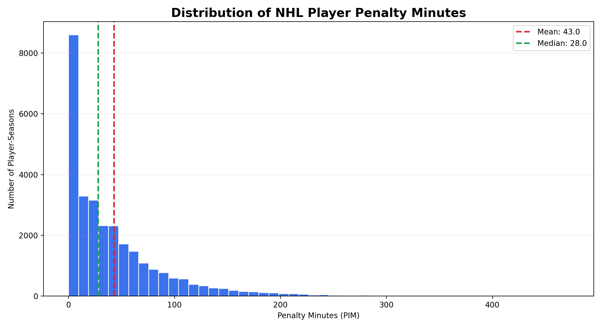
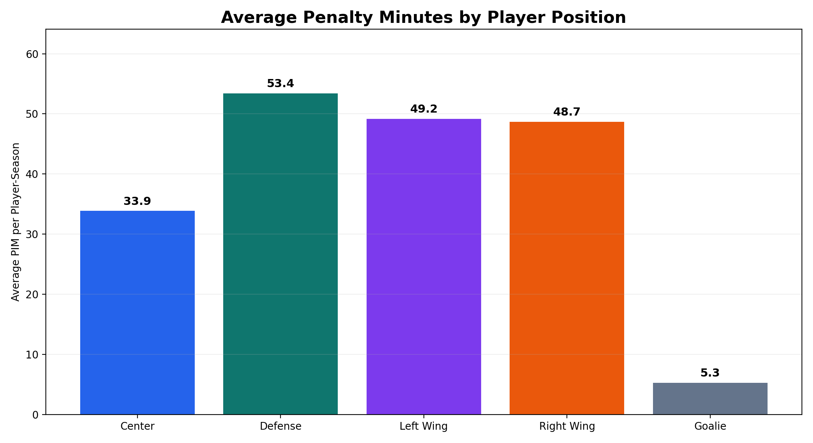
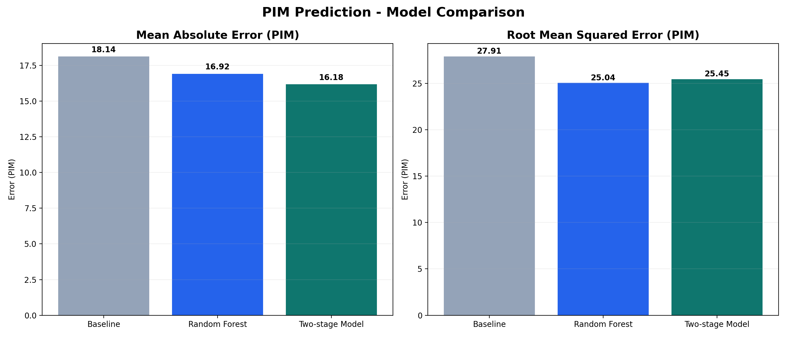
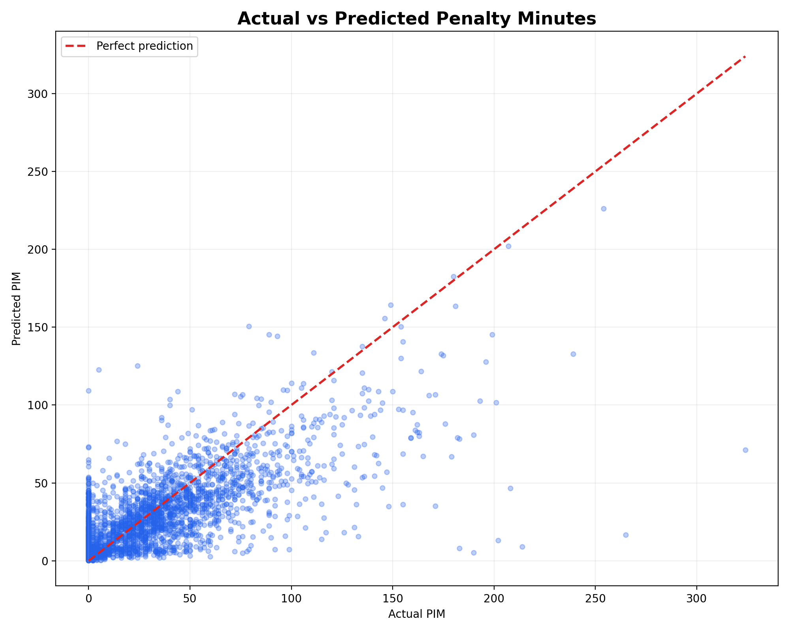
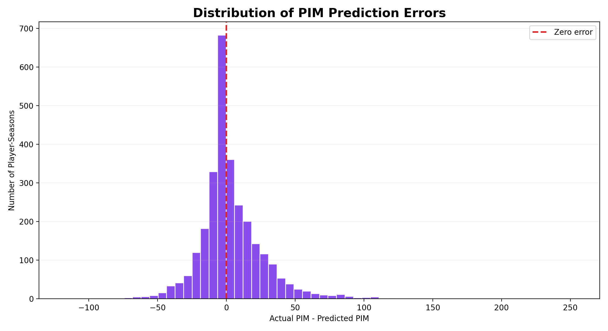

# Question C — Prediction of Player Penalty Minutes (PIM)

## 1. Project Objective

The objective of Question C is to predict how many penalty minutes (PIM) each NHL player will accumulate during the next regular season.

All predictions must be made using only information available before the first game of the target season.

This problem is addressed using a two-stage machine learning approach:

1. **Binary classification:** Predict the probability that a player will participate in the next NHL season.
2. **Regression:** Predict the number of penalty minutes accumulated if the player participates.

The final prediction is calculated as:

**Expected PIM = Probability of Participation × Predicted PIM if Playing**

This approach accounts for the possibility that players active in the previous season may not participate in the following season.

---

## 2. Business Understanding

### 2.1 Business Objective

Predicting penalty minutes can provide useful information for:

- Understanding player disciplinary behaviour.
- Identifying players likely to accumulate high penalty minutes.
- Supporting team and player performance analysis.
- Anticipating potential disciplinary risks.
- Comparing players based on their historical performance.

### 2.2 Data Mining Objective

Develop a predictive model capable of estimating each player's total regular-season PIM using historical information.

The main evaluation metric is **Mean Absolute Error (MAE)**, measured in penalty minutes.

Additional metrics include:

- Root Mean Squared Error (RMSE).
- Coefficient of Determination (R²).
- ROC AUC for the participation classification task.

The main objective is to outperform a simple historical baseline while respecting the chronological structure of the data.

---

## 3. Data Understanding

### 3.1 Data Sources

Two main tables from the NHL historical database were used:

**Scoring.csv**

Contains regular-season player performance statistics, including:

- Player identification (`playerID`).
- Season (`year`).
- Team (`tmID`).
- Position (`pos`).
- Games played (`GP`).
- Penalty minutes (`PIM`).

**Master.csv**

Contains player biographical attributes, including:

- Birth year (`birthYear`).
- Height (`height`).
- Weight (`weight`).
- Playing position (`pos`).

### 3.2 Initial Dataset

After filtering the Scoring table to NHL records:

| Indicator | Value |
|---|---:|
| Original NHL records | 40,101 |
| Distinct players | 6,567 |
| Player-season observations | 36,822 |
| Incomplete player-season observations | 249 |
| Duplicate player-season observations after aggregation | 0 |
| Negative PIM values | 0 |

Players who represented multiple teams during the same season were aggregated into a single player-season observation.

Incomplete records were identified and preserved as missing values rather than automatically replaced with zero.

### 3.3 Exploratory Data Analysis

The exploratory analysis focused on player PIM distributions and differences between playing positions.

For the analysis covering 1968–2009, excluding the cancelled 2004 season:

| Statistic | Value |
|---|---:|
| Valid player-season observations | 29,365 |
| Mean PIM | 43.01 |
| Median PIM | 28.00 |

The PIM distribution is right-skewed, with most player-season observations concentrated at relatively low values and a smaller number of players accumulating very high penalty minutes.

#### Average PIM by Position

| Position | Average PIM |
|---|---:|
| Center (C) | 33.88 |
| Defense (D) | 53.43 |
| Left Wing (L) | 49.19 |
| Right Wing (R) | 48.69 |
| Goalie (G) | 5.27 |

Defencemen accumulated the highest average PIM among the main positions, while goaltenders accumulated considerably fewer penalty minutes.

These differences support including player position as a predictive feature.

### 3.4 Data Understanding Visualizations

**PIM Distribution**



The distribution shows positive skewness and a long right tail, highlighting the presence of high-PIM observations.

**Average PIM by Position**



The chart illustrates differences in average penalty minutes across the five main player positions.

---

## 4. Data Preparation

### 4.1 Data Cleaning

The following operations were performed:

1. Filter records belonging to the NHL.
2. Normalize player identifiers.
3. Convert numerical attributes to appropriate numerical types.
4. Check for duplicate records.
5. Identify missing values.
6. Verify that games played and penalty minutes contain no invalid negative values.
7. Aggregate multiple team records into one player-season observation.
8. Preserve incomplete observations as missing when totals cannot be reliably calculated.

Extreme PIM values were not automatically removed because they may represent legitimate historical performances.

### 4.2 Predictive Dataset Construction

The predictive dataset contains:

| Indicator | Value |
|---|---:|
| Total observations | 28,812 |
| Distinct players | 5,128 |
| Players who participated in the following season | 23,284 |
| Players who did not participate | 5,528 |
| Unknown target values excluded | 46 |
| First target season | 1968 |
| Last target season | 2009 |

The cancelled 2004 season was excluded.

For 2005, the candidate population was selected using the last available NHL season, 2003, without introducing fictitious 2004 observations.

### 4.3 Candidate Selection

For each target season, candidate players were selected based on participation in the previous NHL season.

Historical performance features were calculated using only information from seasons preceding the target season.

Players without a record in the following NHL regular season were assigned zero accumulated NHL PIM.

Players with a record but an unknown PIM value were excluded from supervised training and evaluation.

This approach reflects an important real-world limitation: future player participation is not known with certainty before the season begins.

---

## 5. Feature Engineering

The initial predictive model uses the following features:

| Feature | Description |
|---|---|
| `prev_PIM` | PIM in the previous recorded season |
| `prev_GP` | Games played in the previous recorded season |
| `prev_pim_per_game` | PIM per game in the previous recorded season |
| `avg_PIM_3` | Average PIM over the last three recorded seasons |
| `avg_GP_3` | Average games played over the last three recorded seasons |
| `avg_pim_per_game_3` | Average PIM per game over the last three recorded seasons |
| `experience` | Number of previously recorded NHL seasons |
| `pos` | Last known player position |

Missing numerical features were handled using median imputation fitted exclusively on the training data.

Categorical features were encoded using One-Hot Encoding.

These preprocessing operations were integrated into scikit-learn pipelines.

---

## 6. Machine Learning Models

Three approaches were evaluated.

### 6.1 Historical Baseline

The baseline predicts PIM using the average from the player's previous three recorded seasons.

When the historical average is unavailable, previous-season PIM is used where possible, followed by zero as a fallback.

The baseline provides a reference against which machine learning models can be compared.

### 6.2 Direct Random Forest Regression

A Random Forest regressor directly predicts the player's PIM total for the next season.

The model uses historical performance statistics, experience and position.

The predictions are constrained to non-negative values.

### 6.3 Two-Stage Model

The proposed two-stage approach combines two models.

**Stage 1 — Participation Classification**

A Random Forest classifier estimates the probability that a player will participate in the target NHL season.

**Stage 2 — Conditional PIM Regression**

A Random Forest regressor estimates the player's expected penalty minutes conditional on participation.

The final output is the product of the participation probability and conditional PIM estimate.

This approach explicitly models the possibility of non-participation instead of assuming that every candidate will play.

---

## 7. Experimental Setup

### 7.1 Temporal Division

The dataset was divided chronologically to avoid training models using future-season information.

| Dataset | Seasons |
|---|---|
| Model development training | Up to 2003 |
| Model validation | 2005–2006 |
| Final model training | Up to 2006 |
| Historical test | 2007–2009 |

The 2004 NHL season was cancelled.

Validation was used to compare the original and two-stage approaches before the final historical evaluation.

### 7.2 Evaluation Metrics

**MAE — Mean Absolute Error**

Measures the average absolute difference between predicted and actual PIM.

Lower values indicate better performance.

**RMSE — Root Mean Squared Error**

Measures prediction error while penalizing large errors more strongly.

Lower values indicate better performance.

**R² — Coefficient of Determination**

Measures predictive performance relative to a constant-mean reference.

Higher values generally indicate better performance.

**ROC AUC**

Evaluates the ability of the participation classifier to distinguish players who participate from those who do not.

An AUC of 0.80 does not mean 80% prediction accuracy.

---

## 8. Experimental Results

### 8.1 Validation Results (2005–2006)

| Model | MAE | RMSE |
|---|---:|---:|
| Historical Baseline | 21.329 | 32.820 |
| Direct Random Forest | 19.999 | 28.920 |
| Two-Stage Model | 19.264 | 28.217 |

Participation classifier ROC AUC: **0.807**.

The two-stage approach achieved the lowest MAE and RMSE during validation.

### 8.2 Historical Test Results (2007–2009)

The historical test contains 2,861 candidate player-season observations.

| Model | MAE | RMSE | R² |
|---|---:|---:|---:|
| Baseline | 18.139 | 27.905 | 0.416 |
| Direct Random Forest | 16.921 | **25.040** | **0.530** |
| **Two-Stage Model** | **16.177** | 25.446 | 0.515 |

Participation classifier ROC AUC: **0.801**.

The two-stage model reduced MAE by approximately **10.82% compared with the historical baseline**.

The direct Random Forest achieved the best RMSE and R².

The two-stage model was selected as the final approach because MAE was the primary evaluation metric.

### 8.3 MAE by Test Season

| Season | Two-Stage MAE |
|---|---:|
| 2007 | 16.972 |
| 2008 | 16.347 |
| 2009 | 15.244 |

The results show lower MAE in successive evaluated seasons, although this does not guarantee continued improvement in future seasons.

---

## 9. Model Evaluation Visualizations

### 9.1 Model Comparison



The two-stage model achieved the lowest MAE, whereas the direct Random Forest achieved the lowest RMSE.

### 9.2 Actual vs. Predicted PIM



The scatter plot compares actual and predicted penalty minutes during the historical test.

The model captures general patterns but struggles with some extreme observations, especially players accumulating unusually high PIM.

### 9.3 Prediction Error Distribution



Prediction errors were defined as:

**Error = Actual PIM − Predicted PIM**

The mean signed error was approximately **+3.972 PIM**, indicating average underestimation.

Additional results:

| Indicator | Value |
|---|---:|
| Mean absolute error | 16.177 |
| Mean signed error | +3.972 |
| Largest underestimation | 252.771 |
| Largest overestimation | 117.603 |

Most prediction errors are concentrated near zero, although large errors remain possible.

---

## 10. Additional Feature Engineering Experiment

An additional experiment investigated whether player biographical information improves PIM predictions.

Three features from `Master.csv` were introduced:

- Age, approximated using the target season and birth year.
- Height.
- Weight.

The extended dataset retained all 28,812 observations.

No missing values were detected in these three features after integration.

### 10.1 Validation Results (2005–2006)

| Model | MAE | RMSE | AUC |
|---|---:|---:|---:|
| Original | 19.264 | 28.217 | 0.807 |
| Extended | **18.833** | **27.439** | **0.822** |

The extended model improved validation MAE by approximately 2.24%.

### 10.2 Test Results (2007–2009)

| Model | MAE | RMSE | AUC |
|---|---:|---:|---:|
| Original | **16.177** | 25.446 | 0.801 |
| Extended | 16.197 | **25.395** | **0.812** |

The extended model improved RMSE and participation AUC but did not improve the primary metric, MAE.

Therefore, the original two-stage model was retained for the final predictions.

This test comparison is supplementary because the test period had already been examined in previous experiments. It should not be treated as an entirely independent model-selection experiment.

---

## 11. Prediction Coverage

The candidate selection strategy uses players recorded in the previous season.

Historical coverage was evaluated for the test seasons.

| Season | Actual Players | Covered Players | Coverage |
|---|---:|---:|---:|
| 2007 | 943 | 769 | 81.55% |
| 2008 | 978 | 769 | 78.63% |
| 2009 | 963 | 794 | 82.45% |

Overall historical coverage was approximately **81%**.

Most players not covered by the candidate selection strategy were NHL newcomers.

| Season | Newcomers | Returning Players |
|---|---:|---:|
| 2007 | 146 | 27 |
| 2008 | 170 | 36 |
| 2009 | 137 | 31 |
| Total | 453 | 94 |

Using the previous three seasons instead of only the most recent one increased coverage moderately, but also increased the number of candidate players considerably.

The original candidate selection strategy was retained.

These coverage figures describe the player-selection limitation and are separate from the predictive error metrics.

---

## 12. Final Predictions for 2010

The final two-stage model was trained using all available predictive observations through 2009.

Candidate players were selected based on participation in the 2009 season.

A total of **963 predictions** were generated for the 2010 season.

### 12.1 Prediction Summary

| Indicator | Value |
|---|---:|
| Target season | 2010 |
| Candidate players | 963 |
| Mean predicted PIM | 25.74 |
| Median predicted PIM | 19.10 |
| Maximum predicted PIM | 200.03 |
| Duplicate player IDs | 0 |
| Missing predictions | 0 |
| Negative predictions | 0 |
| Invalid participation probabilities | 0 |

### 12.2 Players with Highest Predicted PIM

| Player ID | Participation Probability | Predicted PIM (Rounded) |
|---|---:|---:|
| `carcida01` | 0.902 | 200 |
| `orrco01` | 0.947 | 168 |
| `konopze01` | 0.849 | 155 |
| `downist01` | 0.906 | 148 |
| `bollja01` | 0.913 | 137 |
| `stortza01` | 0.899 | 128 |
| `carknma01` | 0.867 | 127 |
| `neilch01` | 0.884 | 118 |
| `hartnsc01` | 0.928 | 117 |
| `parroge01` | 0.852 | 115 |

These values are model predictions, not observed 2010 season outcomes.

### 12.3 Prediction Output

The complete prediction table is available at:

`data/pim_predictions_2010_final.csv`

The output includes:

- Player ID.
- Target season.
- Player position.
- Last recorded season.
- Previous-season PIM.
- Average historical PIM.
- NHL experience.
- Estimated participation probability.
- Conditional expected PIM.
- Final predicted PIM.
- Rounded predicted PIM.

---

## 13. Limitations

Despite the improvements achieved, several limitations remain.

### 13.1 Incomplete Candidate Coverage

The model predicts PIM for players active in the previous season.

It does not automatically include every NHL newcomer or returning player.

### 13.2 Unknown Future Participation

Future roster composition, player retirements, injuries and transfers are not fully known before the season begins.

The participation classifier attempts to account for this uncertainty but cannot eliminate it.

### 13.3 Extreme PIM Values

Players accumulating very high PIM remain difficult to predict accurately.

The model may underestimate unusually high penalty totals.

### 13.4 Historical Data

The dataset ends in 2009.

The results cannot be assumed to generalize to modern NHL seasons with different rules and playing conditions.

### 13.5 Model Performance

The two-stage model obtained the best MAE but did not outperform the direct Random Forest in RMSE or R².

No model can guarantee exact PIM predictions.

### 13.6 Additional Data

Potential future improvements include:

- Confirmed preseason rosters.
- Injury and availability information.
- Additional player career attributes.
- Performance data from other hockey leagues.
- More detailed recent-season participation patterns.
- Additional temporal validation experiments.

---

## 14. Project Structure

```text
pim_c/
├── 01_clean_players.py
├── 02_build_dataset.py
├── 03_train_baseline.py
├── 04_two_stage_model.py
├── 05_final_evaluation.py
├── 06_predict_2010.py
├── 07_add_player_features.py
├── 08_compare_features.py
├── 09_data_visualization.py
├── 10_model_visualization.py
├── README.md
├── data/
│   ├── players_clean.csv
│   ├── pim_dataset.csv
│   ├── pim_dataset_extended.csv
│   ├── pim_first_results.csv
│   ├── pim_first_predictions.csv
│   ├── pim_two_stage_validation.csv
│   ├── pim_final_comparison.csv
│   ├── pim_final_two_stage_predictions.csv
│   ├── pim_predictions_2010_final.csv
│   └── pim_feature_comparison.csv
└── plots/
    ├── 01_pim_distribution.png
    ├── 02_pim_by_position.png
    ├── 03_model_comparison.png
    ├── 04_actual_vs_predicted.png
    └── 05_prediction_errors.png
```

The scripts depend on the original `raw_data/Scoring.csv`
and `raw_data/Master.csv` files located in the main project directory.

---

## 15. Reproducibility

### Requirements

Python 3.11 or another compatible Python version with:

- pandas
- numpy
- scikit-learn
- matplotlib

Install dependencies if necessary:

```powershell
py -m pip install pandas numpy scikit-learn matplotlib
```

### Execution Order

Run the following commands from the main `ac` directory:

```powershell
py pim_c/01_clean_players.py
py pim_c/02_build_dataset.py
py pim_c/03_train_baseline.py
py pim_c/04_two_stage_model.py
py pim_c/05_final_evaluation.py
py pim_c/06_predict_2010.py
py pim_c/07_add_player_features.py
py pim_c/08_compare_features.py
py pim_c/09_data_visualization.py
py pim_c/10_model_visualization.py
```

The scripts generate the normalized data, experimental results, final predictions and supporting visualizations.

The main prediction output is:

`pim_c/data/pim_predictions_2010_final.csv`

The main model comparison is:

`pim_c/data/pim_final_comparison.csv`

---

## 16. Conclusion

The project successfully developed a reproducible machine learning approach to estimate NHL player penalty minutes for a future regular season.

Historical player performance, position and participation patterns were used to build predictive models without using target-season statistics as input features.

The two-stage model achieved the lowest MAE in the historical evaluation, with a value of **16.177 PIM**, representing an improvement of approximately **10.82% over the historical baseline**.

The participation classifier achieved a ROC AUC of **0.801**.

The final model generated **963 PIM predictions for the 2010 season**.

Although the approach does not cover all possible new players and does not guarantee exact predictions, the results demonstrate the usefulness of historical performance and participation modelling for estimating future penalty minutes.
